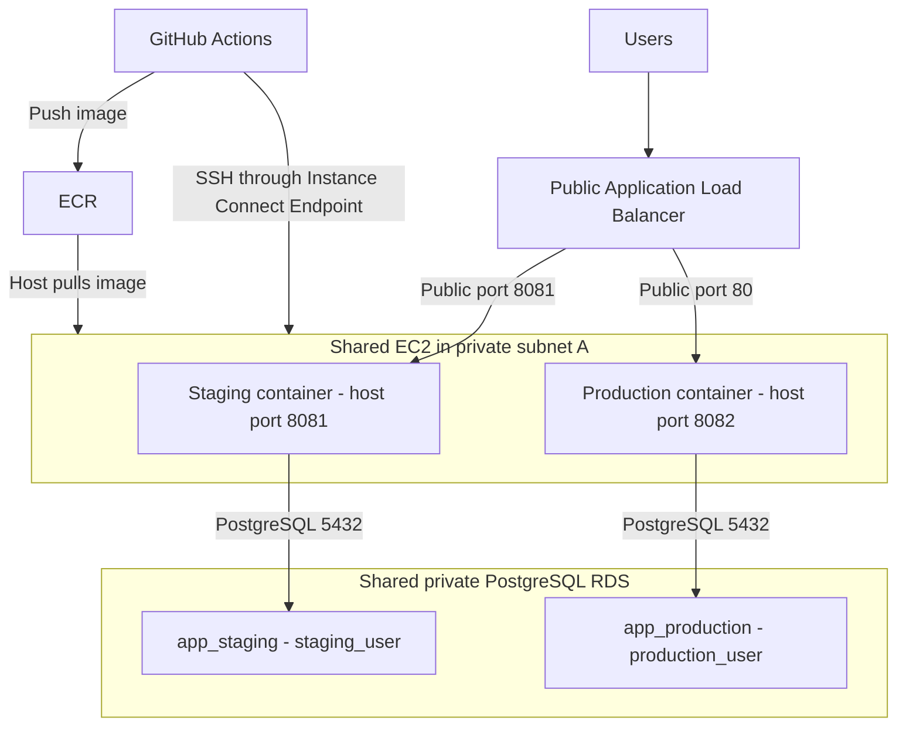

# 8Byte.ai DevOps Assignment

This project shows how to provision AWS infrastructure, test and deploy an application, and collect its logs and metrics. I used Spring PetClinic as the application so I could focus on the DevOps setup.

The setup uses Terraform, GitHub Actions, Docker, EC2, PostgreSQL RDS, ECR, CloudWatch, S3 and Secrets Manager. Staging and production share one EC2 instance and one RDS instance, with separate containers, networks, databases and credentials.

**Current status, 11 October 2026:** the deployed project infrastructure has been removed after the demonstration work. The ALB log bucket, Terraform state bucket and final RDS snapshot were also deleted. Eight application secrets are still scheduled for deletion. Old instance IDs, URLs and SSH host keys should not be reused. This README explains how to create a fresh setup; the commands below have not been run as part of writing this document.

## Contents

- [Architecture and decisions](#architecture-and-decisions)
- [Repository structure](#repository-structure)
- [Set up the infrastructure](#set-up-the-infrastructure)
- [Initialize the databases and secrets](#initialize-the-databases-and-secrets)
- [Configure GitHub Actions](#configure-github-actions)
- [Deploy staging and production](#deploy-staging-and-production)
- [Monitoring and logging](#monitoring-and-logging)
- [Security considerations](#security-considerations)
- [Secret management and backups](#secret-management-and-backups)
- [Cost optimization](#cost-optimization)
- [Local checks](#local-checks)
- [Common issues](#common-issues)
- [Cleanup](#cleanup)
- [Verification and remaining improvements](#verification-and-remaining-improvements)

## Architecture and decisions



The VPC is `10.0.0.0/16` in `us-east-1`.

| Subnet | CIDR | Purpose |
| --- | --- | --- |
| Public A | `10.0.0.0/24` | ALB and NAT gateway |
| Public B | `10.0.1.0/24` | Second ALB subnet |
| Private A | `10.0.10.0/24` | EC2, SSH endpoint and Single-AZ RDS |
| Private B | `10.0.11.0/24` | Second subnet in the RDS subnet group; local routing only |

The public subnets use an internet gateway. Private A uses one NAT gateway for package downloads, image pulls and AWS API calls. Private B has no default internet route. RDS uses a subnet group across two Availability Zones, but runs as one Single-AZ database instance.

| Decision | Reason and trade-off |
| --- | --- |
| EC2 with Docker | A straightforward setup for this assignment, without adding a container orchestration platform. The host still needs maintenance. |
| Shared EC2 and RDS | Reduces cost and keeps the setup manageable. Both environments share capacity and failures, so this does not provide application high availability. |
| Separate containers and databases | Each environment has its own deployment target and restricted database user. Docker networks provide logical separation, not complete isolation. |
| Two public and two private subnets | Supports an internet-facing ALB and an RDS subnet group across two Availability Zones. |
| One ALB with separate HTTP ports | Works with the generated ALB DNS name, without a domain or URL-prefix changes. HTTPS is a later improvement. |
| One Terraform root and S3 state | Matches the shared infrastructure. Child modules organize the code; they do not create separate environment stacks. |
| Build once, promote by digest | Production receives the image from a successful staging run, without rebuilding it. |
| SSH through Instance Connect Endpoint | Reaches private EC2 without a public SSH port, bastion host or permanent deployment key. |

## Repository structure

```text
.
├── README.md                         # Project approach and setup guide
├── app/                              # Spring PetClinic, tests and Dockerfile
├── deploy/                           # SSH connection and container deployment
├── .github/workflows/                # PR checks, staging and production
└── 8Byte-Infra/
    ├── backend.tf                    # S3 state and locking
    ├── main.tf                       # Connect the eight child modules
    ├── providers.tf                  # AWS region, account check and tags
    ├── variables.tf                  # Configurable inputs
    ├── outputs.tf                    # IDs, ARNs, URLs and dashboard links
    ├── versions.tf                   # Terraform and provider constraints
    ├── moved.tf                      # Previous resource addresses mapped to modules
    ├── environments/shared.tfvars.example
    ├── modules/                      # network, registry, database, logging,
    │                                 # compute, load_balancer, pipeline, monitoring
    ├── scripts/                      # Database initialization and checks
    └── tests/                        # Mocked Terraform tests
    
```

Run Terraform from `8Byte-Infra/`. The [infrastructure README](8Byte-Infra/README.md) explains the modules and state migration in more detail. The [application README](app/README.md) contains the upstream PetClinic documentation.

## Set up the infrastructure

### 1. Check the prerequisites

Install Terraform, AWS CLI v2, Git, Python 3 and OpenSSH. Java 17 and Docker are needed for local application tests. Maven is provided through `app/mvnw`.

Use an authenticated AWS operator profile with permission to provision the resources and initialize the database. The GitHub deployment role has a smaller permission set and is not the Terraform operator role.

```bash
git clone https://github.com/shivshashya/8byte.ai-e2e-Workflow.git
cd 8byte.ai-e2e-Workflow
terraform version
aws --version
aws sts get-caller-identity
```

The Terraform configuration requires version `>= 1.10.0, < 2.0.0`. Keep `.terraform.lock.hcl` committed so provider installation uses the reviewed version. Confirm that the AWS account shown by the last command is the account you intend to use.

### 2. Review the Terraform inputs

```bash
cp 8Byte-Infra/environments/shared.tfvars.example 8Byte-Infra/environments/shared.tfvars
```

Edit `shared.tfvars` before continuing:

- Set `aws_account_id`, region and Availability Zones for your account.
- Review the EC2 AMI, instance size, RDS version and storage. The defaults are `t3.medium`, PostgreSQL `18.4`, `db.t3.small`, 30 GiB EC2 storage and 20 GiB RDS storage. Verify availability before creating a fresh setup.
- Choose an unused `database_secret_suffix`, then keep it stable for that deployment. Previously deleted secret names can remain reserved during the recovery window.
- Choose an unused `rds_final_snapshot_identifier` for the new database.
- Set `pipeline_alert_email` to an address you can confirm.
- If using another GitHub repository, update `github_repository`, `github_owner_id` and `github_repository_id`, and verify its actual OIDC subject format.

For the current deployment scripts, keep `project_name = "8byte-devops"` and application host ports `8081`/`8082`. Those values are also used in the scripts; changing them requires updating both sides. Actual `.tfvars` files are ignored by Git. Do not put passwords or access keys in them.

### 3. Create the S3 state bucket

The backend bucket is created separately from the main Terraform stack. The previous `8byte.ai` bucket has been deleted. Choose an available bucket name; the example below uses your account ID. Run these commands in the same terminal as the next Terraform step.

```bash
task_account_id="$(aws sts get-caller-identity --query Account --output text)"
task_state_bucket="8byte-terraform-state-${task_account_id}"

aws s3api create-bucket --bucket "$task_state_bucket" --region us-east-1
aws s3api put-bucket-versioning --bucket "$task_state_bucket" \
  --versioning-configuration Status=Enabled
aws s3api put-bucket-encryption --bucket "$task_state_bucket" \
  --server-side-encryption-configuration '{"Rules":[{"ApplyServerSideEncryptionByDefault":{"SSEAlgorithm":"AES256"}}]}'
aws s3api put-public-access-block --bucket "$task_state_bucket" \
  --public-access-block-configuration BlockPublicAcls=true,IgnorePublicAcls=true,BlockPublicPolicy=true,RestrictPublicBuckets=true
```

These creation commands are for `us-east-1`. If the bucket name is taken, choose another unique name before running them. The operator needs access to the bucket and state object, plus read/write/delete access to the lock object.

The state key is `shared/terraform.tfstate`. Native S3 locking uses `shared/terraform.tfstate.tflock`, which is removed when the lock is released. Versioning keeps previous state versions for recovery. See the [Terraform S3 backend documentation](https://developer.hashicorp.com/terraform/language/backend/s3).

### 4. Plan and apply

The bucket override below replaces the old bucket name in `backend.tf`. Use the same bucket for all later initialization and state operations for this deployment.

```bash
terraform -chdir=8Byte-Infra init -reconfigure -backend-config="bucket=$task_state_bucket"
terraform -chdir=8Byte-Infra fmt -check -recursive
terraform -chdir=8Byte-Infra validate
terraform -chdir=8Byte-Infra plan -var-file=environments/shared.tfvars -out=reviewed.tfplan
```

Review additions, updates, replacements and deletions. After approving the plan:

```bash
terraform -chdir=8Byte-Infra apply reviewed.tfplan
terraform -chdir=8Byte-Infra output
```

Terraform writes state to S3 as it records changes. Do not reuse a saved plan after an apply or a configuration change. Creating this stack starts AWS charges; review the cost section before applying.

## Initialize the databases and secrets

Terraform creates the application secret containers, but does not put passwords in them. Initialize them before the first application deployment.

First connect to the new instance. Wait for EC2 bootstrap to finish; check `/var/log/cloud-init-output.log` if Docker or the required tools are missing.

```bash
task_instance_id="$(terraform -chdir=8Byte-Infra output -raw ec2_instance_id)"
task_endpoint_id="$(terraform -chdir=8Byte-Infra output -raw ssh_endpoint_id)"
aws ec2-instance-connect ssh --instance-id "$task_instance_id" \
  --connection-type eice --eice-options "endpointId=$task_endpoint_id" \
  --os-user ec2-user --region us-east-1
```

The [AWS CLI SSH command](https://docs.aws.amazon.com/cli/latest/reference/ec2-instance-connect/ssh.html) reaches EC2 through the endpoint. For the first connection, verify the host fingerprint through the EC2 console before accepting it. In the server shell, read the public host key:

```bash
sudo cat /etc/ssh/ssh_host_ed25519_key.pub
ssh-keygen -lf /etc/ssh/ssh_host_ed25519_key.pub
```

Copy only `ssh-ed25519` and its encoded public key. It identifies the server and is safe to store as a GitHub variable. It is different from the temporary login key generated for each deployment. Never copy the private host-key file.

The database initializer connects by private IP with strict host-key checking. Before running it, save the verified public key under that IP in your local `known_hosts`. Exit the EC2 shell, then run locally, replacing the example public key:

```bash
task_private_ip="$(terraform -chdir=8Byte-Infra output -raw ec2_private_ip)"
task_host_key='ssh-ed25519 REPLACE_WITH_VERIFIED_PUBLIC_KEY'
mkdir -p ~/.ssh
chmod 700 ~/.ssh
printf '%s %s\n' "$task_private_ip" "$task_host_key" >> ~/.ssh/known_hosts
chmod 600 ~/.ssh/known_hosts
python3 8Byte-Infra/scripts/initialize_databases.py --execute
```

If the same private IP has an old saved key, verify the replacement first, then remove the old entry with `ssh-keygen -R "$task_private_ip"` before adding the new key. Keep strict checking enabled.

The initializer uses the local operator identity to read the RDS admin secret. It installs a PostgreSQL client on EC2 if needed, creates the two databases/users, stores separate generated passwords in Secrets Manager, and checks access isolation and persistence. Rerunning it reuses matching existing credentials rather than rotating them. Run it during setup, not on every release.

| Environment | Database | User | Container | Docker network | EC2 host port |
| --- | --- | --- | --- | --- | --- |
| Staging | `app_staging` | `staging_user` | `petclinic-staging` | `staging-net` | `8081` |
| Production | `app_production` | `production_user` | `petclinic-production` | `production-net` | `8082` |

## Configure GitHub Actions

Open **Repository Settings → Secrets and variables → Actions → Variables**. Add the following repository variables. These are identifiers and public configuration, not database passwords or AWS access keys.

| Variable | Value or source |
| --- | --- |
| `AWS_REGION` | `us-east-1` |
| `AWS_ROLE_ARN` | Terraform output `github_actions_role_arn` |
| `AWS_NOTIFY_ROLE_ARN` | Output `github_notifications_role_arn` |
| `ECR_REPOSITORY_URL` | Output `ecr_repository_url` |
| `ECR_REPOSITORY_NAME` | `8byte-petclinic`, matching the Terraform input |
| `EC2_INSTANCE_ID` | Output `ec2_instance_id` |
| `EC2_SSH_HOST_KEY` | Verified public host key from the new EC2 |
| `DATABASE_SECRET_SUFFIX` | Same value as `database_secret_suffix` in `shared.tfvars` |
| `STAGING_URL` | `staging` value in output `application_urls` |
| `PRODUCTION_URL` | `production` value in output `application_urls` |
| `SNS_TOPIC_ARN` | Output `pipeline_failure_topic_arn` |

Read an individual output with `terraform -chdir=8Byte-Infra output -raw <output_name>`. Use `terraform -chdir=8Byte-Infra output application_urls` for both URLs.

Click the SNS subscription confirmation link sent by AWS. Email delivery starts only after confirmation, including after recreating the topic/subscription.

GitHub uses OIDC to obtain temporary AWS credentials. The deployment role trusts this repository's `main` branch. A separate role trusts main and pull-request subjects and can only publish to the failure topic. The trust policy uses immutable repository/owner IDs; verify them if moving or copying this setup. No GitHub environments are configured.

Update the instance ID, host key, role ARNs and URLs after recreation. Enable branch protection to require PR checks before merging; that repository setting is configured separately from these workflow files.

## Deploy staging and production

### Pull request checks

[PR checks](.github/workflows/pr-checks.yml) runs unit tests, integration tests and a dependency scan for pull requests targeting `main`. Integration tests include Docker-based PostgreSQL and MySQL tests.

Trivy reports HIGH and CRITICAL findings. The blocking scan fails on CRITICAL vulnerabilities with an available fix. Other reported findings still need review; a passing run does not mean there are no vulnerabilities.

### Staging deployment

The [staging workflow](.github/workflows/build-and-deploy-staging.yml) runs on pushes to `main` that change `app/`, `deploy/` or that workflow file. A README-only or Terraform-only change does not trigger it.

The workflow builds the image, scans it, pushes it to ECR with the commit SHA as an immutable tag, and deploys by digest. A rerun reuses an image already stored for that commit. The Docker build skips tests, so PR checks should pass before merging.

Deployment uses SSH through the endpoint. On EC2, the host role pulls the image and reads the matching database secret. The script replaces only the staging container, sets a 768 MiB memory limit and 0.75 CPU limit, and checks application health plus a database-backed page. The workflow then checks the public staging homepage through the ALB.

### Production promotion

1. Open **Actions → Build and deploy to staging** and select a successful push-to-main run whose staging deployment passed.
2. Copy the number after `/actions/runs/` in its URL. For example, `/actions/runs/123456789` gives the run ID `123456789`.
3. Open **Actions → Deploy to production → Run workflow**.
4. Select `main`, enter that number as `staging_run_id`, and start the workflow.

Starting this workflow is the manual approval used here. It records who started it and which staging run was selected. It is not a separate required-reviewer approval gate. See [GitHub's manual workflow guide](https://docs.github.com/en/actions/how-tos/manage-workflow-runs/manually-run-a-workflow).

The [production workflow](.github/workflows/deploy-production.yml) rejects PR, failed or production run IDs. It finds the image using the successful staging run's commit and deploys the same digest to the production container. It does not rebuild the image.

### Health checks and rollback

The ALB sends health checks directly to `/actuator/health` on each environment's host port. Public `/actuator` paths return 404. After deployment, the homepage should respond through the appropriate listener:

```bash
terraform -chdir=8Byte-Infra output application_urls
```

Open the returned URLs in a browser: production uses HTTP port `80`, and staging uses HTTP port `8081`.

If the image cannot be pulled or the secret cannot be read, deployment stops before removing the existing container. If the new container fails startup or its local health check, the script attempts to restore the previous image. This causes brief downtime and restores the application image only, not database changes. A first deployment has no previous image to restore. A later public ALB check failure does not itself trigger the script's rollback.

## Monitoring and logging

Terraform defines two CloudWatch dashboards:

| Dashboard | What it shows |
| --- | --- |
| `8byte-devops-infrastructure-database` | EC2 CPU, memory and root-disk usage; RDS CPU, connections, free memory/storage and read/write latency |
| `8byte-devops-application` | Requests per minute, target 5xx percentage, average/p95 response time and target health by environment; shared ALB errors |

EC2 CPU comes from native five-minute metrics. The CloudWatch collector sends memory and disk metrics every minute. Application metrics come from the ALB target groups and represent traffic through the ALB, not all internal application activity. Host and RDS usage is shared and is not measured separately for each environment.

| Log source | Destination | Default retention |
| --- | --- | --- |
| Container stdout/stderr | CloudWatch `/8byte-devops/application`, separate container streams | 14 days |
| System, SSH and bootstrap logs | CloudWatch `/8byte-devops/system`, separate source streams | 14 days |
| ALB access logs | Dedicated private S3 bucket under `alb/` | 30 days |

```bash
terraform -chdir=8Byte-Infra output monitoring_dashboards
terraform -chdir=8Byte-Infra output logging_destinations
```

After deployment, open the dashboards, generate normal traffic through both URLs, and confirm fresh metrics and logs. ALB log delivery is delayed. Docker uses non-blocking log delivery with a bounded buffer, so a prolonged delivery outage can lose logs. No CloudWatch metric alarms are defined; SNS handles workflow failure notifications.

## Security considerations

- **Private resources:** EC2 has no public IP and RDS is not publicly accessible.
- **Security-group references:** EC2 accepts application traffic on `8081`/`8082` from the ALB group, SSH on `22` from the endpoint group, and RDS accepts `5432` from the EC2 group. No public SSH or database ingress is configured.
- **Scoped identities:** GitHub receives temporary credentials through OIDC. Image push/pull and SSH permissions are scoped to the project resources. The EC2 role can pull images, read both application secrets and publish project logs/metrics, but cannot read the RDS admin secret.
- **Server identity:** deployment checks the saved EC2 SSH public host key. The connection script permits first-use acceptance when that variable is empty; configure it for pipeline deployments.
- **Credentials:** secret values stay outside Terraform. Protected temporary files pass settings to Docker and are removed after deployment. Credentials remain in container environment settings and can be read by a host administrator.
- **Runtime:** the application runs as a non-root container user, with CPU/memory limits. EC2 requires IMDSv2. These controls do not make the shared host a strong security boundary between environments.
- **Encryption:** EC2/RDS storage and S3 log storage are encrypted. The state bucket setup above enables encryption and public-access blocking. Treat state, plans and logs as sensitive and restrict access.

The demo uses HTTP, and PostgreSQL TLS is supported but not mandatory (`rds_require_tls = false`). HTTPS and mandatory verified database TLS are improvements for a real production setup. Separate Docker networks do not prevent access through the shared host's published ports; that path was reachable in earlier testing.

## Secret management and backups

Both assignment options are included in the configuration.

**Secret management:** RDS creates and manages the admin password in Secrets Manager. Separate staging and production application secrets contain `engine`, `host`, `port`, `dbname`, `username` and `password`. The initializer populates their values outside Terraform. Application users own only their respective databases, with cross-database access revoked and no superuser, database-create or role-create privileges. Application password rotation is not automated.

**Backup strategy:** RDS has seven-day automated backup retention, encrypted storage, deletion protection and a final snapshot on deletion. This supports restoring a database after an incident, but a restore exercise has not been recorded. Image rollback does not undo database changes. Final snapshots are retained separately until explicitly deleted; the snapshot from the last cleanup has now been deleted.

## Cost optimization

The main choices are practical for a short assignment:

- Share EC2, RDS and ALB between staging and production.
- Use one NAT gateway for the active private subnet instead of one per Availability Zone.
- Use Single-AZ RDS and modest gp3 storage, accepting the availability trade-off.
- Use Standard CPU credits for EC2 to avoid surplus credit charges; sustained load can be throttled.
- Keep the newest 30 ECR images by default. Check that required deployment and rollback images have not expired.
- Keep CloudWatch logs for 14 days and ALB access logs for 30 days.
- Collect two custom host metrics at one-minute resolution, and use native service metrics for the rest.
- Remove the stack after the demonstration, then check retained snapshots, buckets, object versions and secrets separately.

NAT, ALB, public IPv4 addresses, databases and storage can cost money even with little traffic. Check current regional prices and your account's allowances before applying: [AWS Pricing Calculator](https://calculator.aws/), [VPC pricing](https://aws.amazon.com/vpc/pricing/), [RDS pricing](https://aws.amazon.com/rds/postgresql/pricing/) and [CloudWatch pricing](https://aws.amazon.com/cloudwatch/pricing/).

## Local checks

Application checks, from `app/`, with Java 17 and Docker running:

```bash
./mvnw -B test -Dtest='!*IntegrationTests'
./mvnw -B test -Dtest='*IntegrationTests'
```

For a local PostgreSQL development run, from the repository root:

```bash
docker compose -f app/docker-compose.yml up -d postgres
cd app
SPRING_PROFILES_ACTIVE=postgres ./mvnw spring-boot:run
```

Open `http://localhost:8080`. The Compose credentials are sample development values and must not be used for AWS. Stop the application with Ctrl+C, return to the repository root, then run `docker compose -f app/docker-compose.yml down`.

Terraform checks without an S3 backend, from the repository root:

```bash
task_tf_data_dir="$(mktemp -d)"
TF_DATA_DIR="$task_tf_data_dir" terraform -chdir=8Byte-Infra init -backend=false
TF_DATA_DIR="$task_tf_data_dir" terraform -chdir=8Byte-Infra validate
TF_DATA_DIR="$task_tf_data_dir" terraform -chdir=8Byte-Infra test
terraform -chdir=8Byte-Infra fmt -check -recursive
```

The two Terraform tests use a mocked provider. They check monitoring and logging configuration without provisioning resources or proving live delivery. The temporary data directory avoids cached settings from the deleted backend. Use this mode for validation, not for a live apply.

## Common issues

| Issue | What to check |
| --- | --- |
| `SendSSHPublicKey` access denied | Check `EC2_INSTANCE_ID`, `ec2-user` and the applied IAM policy. The role allows the managed application instance, not an old instance ID. |
| SSH host identification changed | Verify the new EC2 host fingerprint and update `EC2_SSH_HOST_KEY`. Do not disable strict checking. |
| Secret has no `AWSCURRENT` value | Run the database initializer after apply, and make sure `DATABASE_SECRET_SUFFIX` matches Terraform. |
| Secret name already exists | A deleted secret can still reserve its name. Use a fresh suffix for a fresh deployment, then keep it stable. |
| Production run cannot be promoted | Supply a successful staging push-to-main run ID, not a production run ID or commit SHA. |
| ALB returns 502/503 | Check the container, local health endpoint and target-group health. Creating the ALB alone does not deploy the application. |
| Terraform cannot find the backend bucket | Create the bucket before initialization and use the correct backend bucket override. |
| Dashboard is empty | Confirm the collector is active, the resource IDs are current and requests are going through the ALB. |

## Cleanup

Keep the state bucket until Terraform has finished destroying the managed resources.

1. Review whether to retain database snapshots, ECR images and logs.
2. Set `rds_deletion_protection = false` in `shared.tfvars`, create a fresh plan and apply the reviewed protection change. If ALB deletion protection was enabled, disable it through the same reviewed process.
3. Empty the project ECR repository and ALB log bucket if deleting them. `force_delete`/`force_destroy` are deliberately disabled. For a versioned bucket, removing current objects alone is not enough: old versions and deletion markers must also be removed.
4. Create and review the destroy plan:

   ```bash
   terraform -chdir=8Byte-Infra plan -destroy -var-file=environments/shared.tfvars -out=cleanup.tfplan
   terraform -chdir=8Byte-Infra apply cleanup.tfplan
   terraform -chdir=8Byte-Infra state list
   ```

5. Confirm state is empty and check AWS for remaining resources. The final RDS snapshot needs an available identifier. Application secrets use a seven-day recovery window and remain pending deletion during that period.
6. Delete retained snapshots only when the backup is no longer needed. Empty and delete the manually created state bucket last, including all object versions and deletion markers.

Review the exact account and resource names before deletion. Deleting the backend destroys its recovery history; do it only after the deployment is fully removed.

## Verification and remaining improvements

Earlier deployment checks recorded working SSH/Docker access, staging and production HTTP responses, and database access isolation and persistence. The module restructure passed Terraform formatting/validation and two mocked tests. These are historical results; there is no running deployment now. An AWS migration plan/result for the module restructure has not been recorded.

A controlled unhealthy-release rollback test, a database restore exercise and fresh monitoring/log delivery evidence still need to be recorded before claiming those behaviours are fully demonstrated. Successful SNS publication and confirmed subscription do not by themselves prove that every failure email reached the inbox.

For a production platform, the next changes would be HTTPS, stronger environment separation, multiple application hosts, Multi-AZ RDS, a separate reviewer approval gate and monitoring alarms. Those changes are outside this assignment setup and are not implemented here.

Spring PetClinic is an existing [Spring project](https://github.com/spring-projects/spring-petclinic), distributed under the [Apache 2.0 licence](app/LICENSE.txt).
